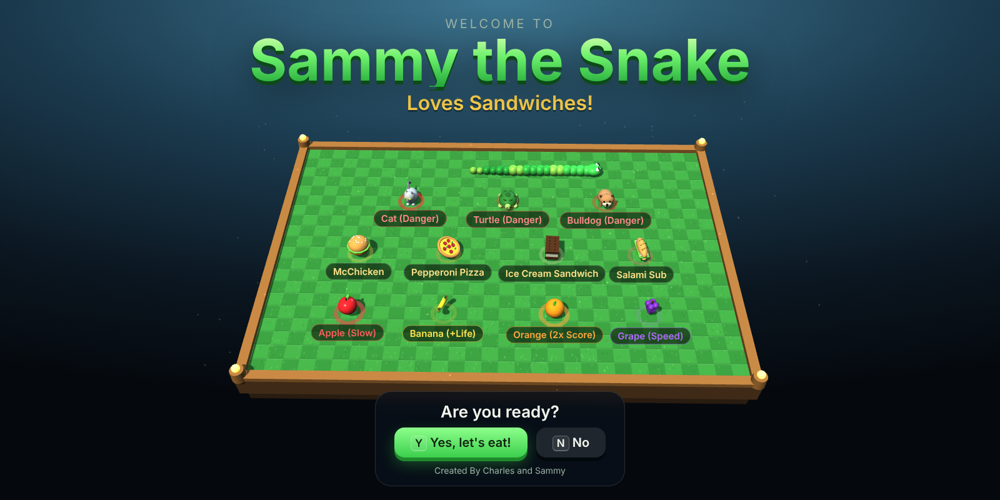
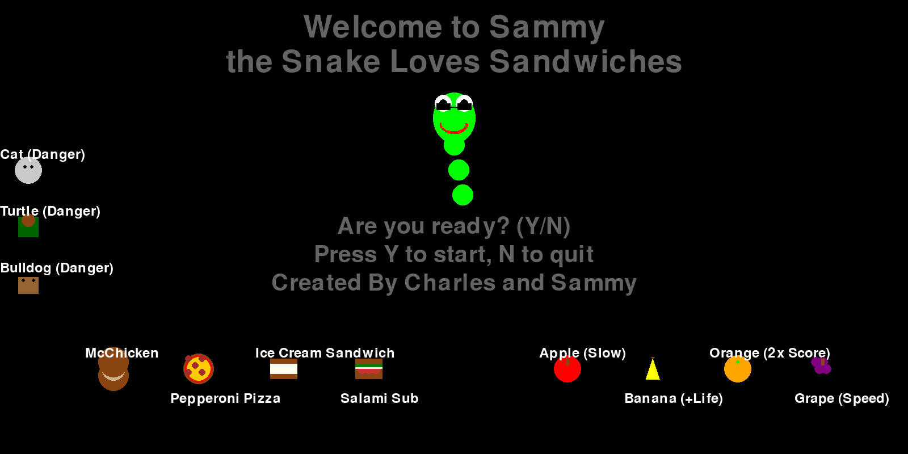
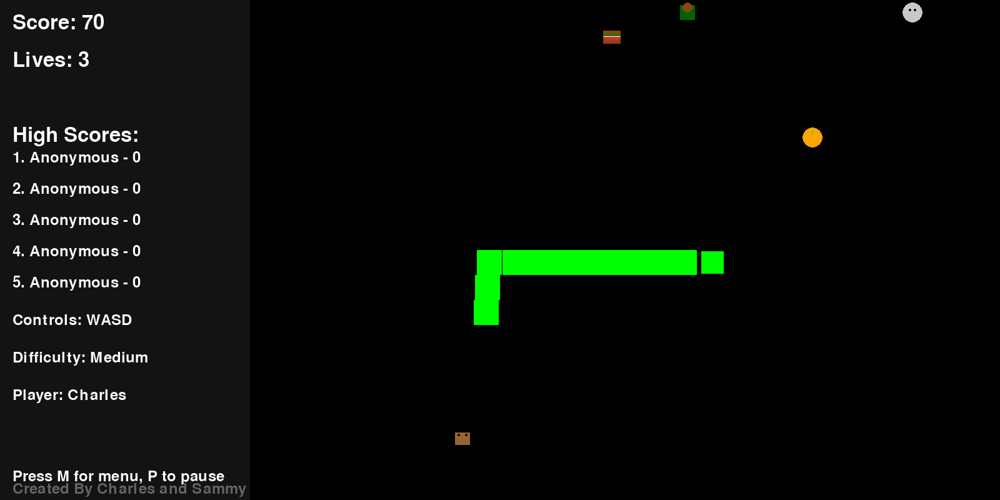
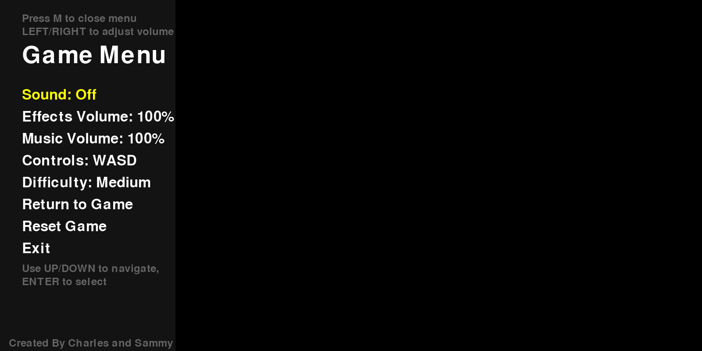
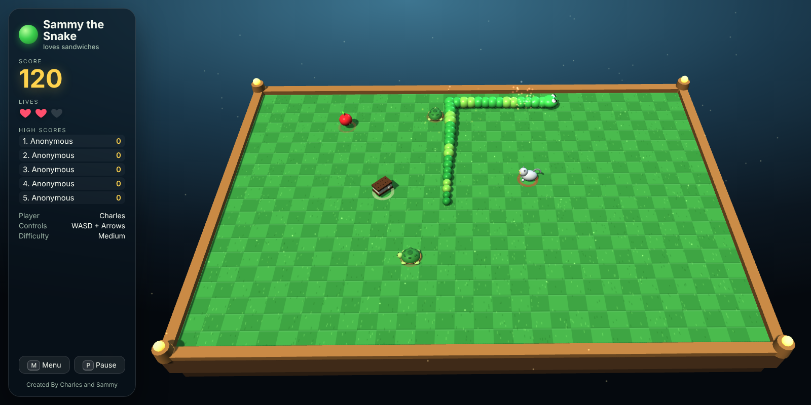
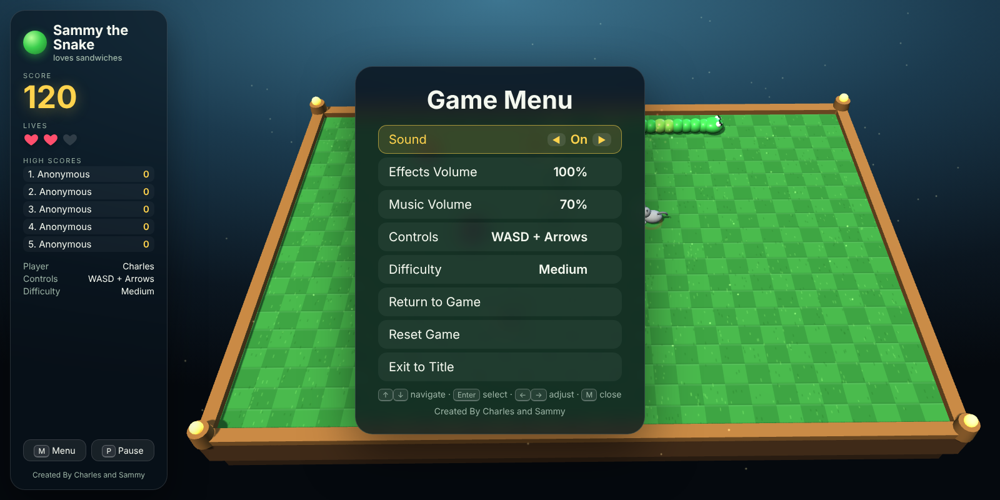
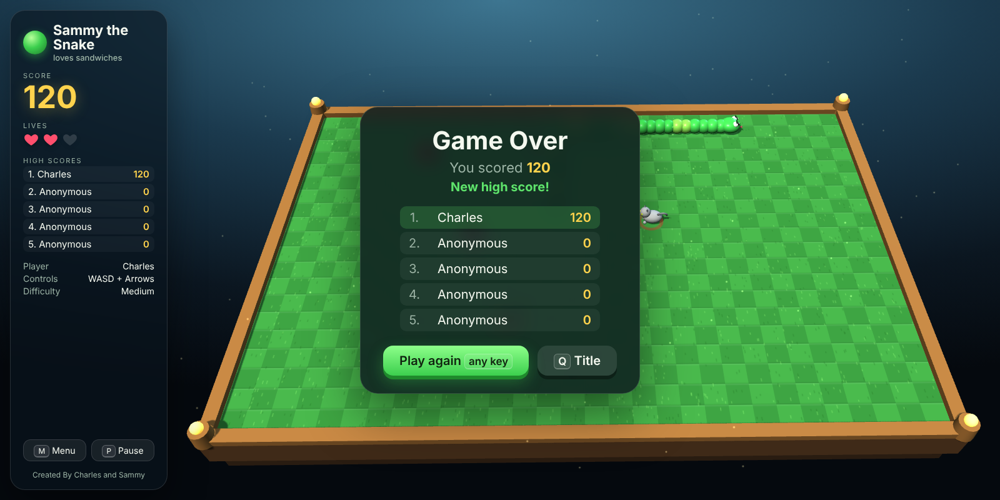

# Sammy the Snake 3D 🐍🥪

**Sammy the Snake Loves Sandwiches**, now in 3D and running in any web browser.

*Created By Charles and Sammy*

---

## Our story: one year, two versions

### November 2025: the first version

My son and I wanted to make our own game. We had an idea we loved: a snake named Sammy who eats sandwiches instead of apples, dodges cats, turtles and bulldogs, and picks up fruit for power-ups. We built it in Python with Pygame, going back and forth between Google Gemini and Grok.

It took us forever. Every change broke something else, and we spent most of our time copying code between chat windows and trying to figure out why it wouldn't run. We got there in the end, and we were proud of it. It was about the best we could come up with.

| | |
|---|---|
|  |  |
| *The original title screen* | *The original gameplay* |

*The original menu*

### November 2026: the remake with Claude

A year later I uploaded that same Python file to Claude and asked it to go through the game, make it better looking, make it more 3D, and turn it into HTML.

About 40 minutes later, in one conversation, it was done. Claude:

- read through all 770 lines of our original game and kept everything that made it ours: the sandwiches, the fruit power-ups, the cat, turtle and bulldog, the 3 lives, the high scores, the menu and the name prompt
- rebuilt it as a real 3D game with lighting, shadows, animated animals and a snake with a face
- found and fixed bugs we never knew were there (the first sandwich didn't make Sammy grow, food could appear on top of an obstacle, and quick key presses could make Sammy turn back into himself)
- fixed the music: the songs we'd typed in as lists of frequencies were coming out wrong, so it rewrote each one with the real notes and rhythms, added Canon in D and other classics we'd wanted, and turned our little arcade jingle into a full title theme
- played the game itself in a test browser to check it worked, took the screenshots on this page, and put it all on GitHub for us

| | |
|---|---|
|  |  |
| *The 3D version* | *The new menu* |

*Game over, with the high score board*

### What changed

Last year, AI was a tool we fought with. We did the building, and it gave us pieces we had to glue together ourselves.

Now it's more like having a partner who builds what we describe. In the year since the first Sammy, I've made games, Raspberry Pi tools, Meshtastic radio projects and web apps that I never could have made before. The idea still comes from us. The difference is how quickly an idea becomes something real that my kids can actually play.

Same game, same idea, same names in the credits. One year apart.

---

## How to play

Open `index.html` in a web browser (Chrome, Edge, Firefox or Safari). It needs an internet connection the first time so it can load the 3D engine.

- **Y** to start, then type your name and press **Enter**
- Move with **WASD** or the **arrow keys** (or swipe on a phone or tablet)
- **M** opens the menu, **P** pauses
- The snake wraps around the edges of the board

### Food (eat these!)
McChicken, Pepperoni Pizza, Ice Cream Sandwich, Salami Sub: each is worth 10 points.

### Power-ups (fruit)
| Fruit | What it does |
|---|---|
| 🍎 Apple | Slows Sammy down for 10 seconds |
| 🍌 Banana | +1 life (up to 5) |
| 🍊 Orange | 2x score for 10 seconds |
| 🍇 Grape | Speed boost for 5 seconds |

### Danger
Don't run into the **cat**, **turtle**, **bulldog**, or yourself. You have 3 lives.

The animals don't sit still! Every 20 seconds each one hops to a new spot (they take turns, so they never all move at once). A **red ring** shows where it will land, so stay out of it. In between, the cat meows, the bulldog barks, and the turtle does a little spin.

## Music

The title screen plays **Sammy's Theme**, built from the arcade jingle in the original game. During play, the game cycles through:

Canon in D (Pachelbel) · Ode to Joy (Beethoven) · Eine kleine Nachtmusik (Mozart) · Minuet in G (Petzold) · Spring (Vivaldi) · In the Hall of the Mountain King (Grieg, and it speeds up!) · Für Elise (Beethoven) · Twinkle, Twinkle, Little Star · Yankee Doodle · Mary Had a Little Lamb · Frère Jacques (sung as a round)

Use the **pause** and **next** buttons beside "Now playing" on the left panel, or pick a song from the **Song** option in the menu (M).

## The original

`original/SNAKE-Final.py` is the first version from November 2025, kept exactly as we made it.
To run it: `pip install pygame numpy` and then `python SNAKE-Final.py`.
